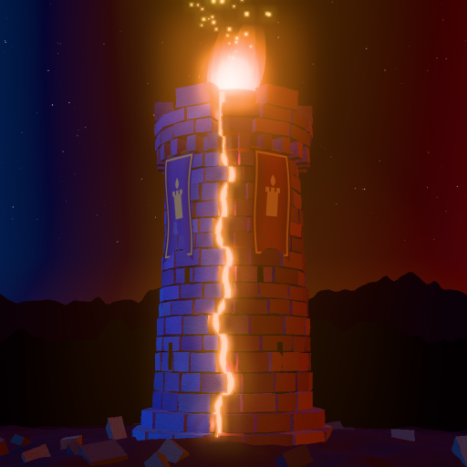

<p align="center">
  
</p>

<h1 align="center">Ovra</h1>

<p align="center">
  <b>A 3v3 lane-strategy game for phones.</b><br/>
  Push down the lanes, break the towers and barracks, then destroy the enemy <b>Shrine</b>.
</p>

<p align="center">
  <a href="https://itsmoemousavi.github.io/ovra-game/"><b>▶ Play it in your browser</b></a> ·
  <a href="CHANGELOG.md">Patch notes</a> ·
  <a href="docs/DESIGN.md">Design notes</a>
</p>

<p align="center">
  
</p>

> **Status:** in development, version **0.17.13** (see the [patch notes](CHANGELOG.md)). Play against bots, or with friends using a game code. Online matchmaking and app-store releases come later.

## What's in the game

- **3v3 matches** on three lanes, against bots that play as a team (they farm, push, defend and hunt the boss). Choose Easy, Normal or Hard bots.
- **Play with Friend:** one phone hosts and shares a 4-letter code, friends join from their own phones (Wi-Fi or mobile data), and bots fill any empty seats. Any player can pause (3 times per match), and a player who drops out can rejoin.
- **Draft inside the match:** each team bans one hero, then picks go 1-2-2-1, followed by a 30-second warm-up.
- **Nine heroes**, each with three abilities (R is the ultimate):

  | Hero | Role | Abilities |
  |---|---|---|
  | **Brakk** the Bulwark | Tank / Initiator | Shield Charge · Iron Hide · Earthsplitter |
  | **Vexa** the Gale Archer | Ranged Carry | Piercing Arrow · Hunter's Rhythm · Arrow Storm |
  | **Orin** the Emberseer | Mage / Support | Fireball · Mending Flame · Cataclysm |
  | **Syl** the Shadeblade | Melee Assassin | Shadow Lunge · Veil · Execution |
  | **Grom** the Ironroot | Bruiser / Controller | Root Snare · Bark Skin · Overgrowth |
  | **Kaela** the Tidecaller | Support / Controller | Tidal Wave · Brine Veil · Maelstrom |
  | **Morra** the Beastcaller | Summoner | Call the Pack · Feral Bond · Red Wolf |
  | **Seren** the Aegis | Support / Protector | Aegis · Rebuke · Sanctuary |
  | **Rhen** the Galewalker | Mobile Ranged Carry | Gale Step · Hawk Mark · Bolt Storm |

- **A real map:** towers, two barracks per lane, shrine towers, a winding river, woods that block sight, mountains you can only reach by blinking or charging, high ground, fog of war, day and night, runes, jungle camps, and the **Warden** boss, which moves between two walled houses on the river. Break all six enemy barracks and your side gets **Mega Creeps**.
- **Items and a shop** with combined items, totems for sight, teleport scrolls, selling and dropping items, plus a **courier** that brings your items to you.
- **Sounds and an announcer:** natural sound effects, a war horn at the start, a voice for towers, kill streaks and the Warden, and a song when the Shrine falls.
- **Your own name:** pick a display name in Settings → Profile. It shows in the lobby, the draft, the kill feed and over your hero.
- **Made for phones:** joystick and buttons, drag to aim spells, always landscape. Works with mouse and keyboard on a computer too.
- **3D view** (Three.js), with a light 2D view for older phones.
- **Practice mode** and a **tutorial** of eight short lessons you can play in any order.
- **End screen** with the match's best player, a scoreboard, gold and experience graphs, and Play Again.

## Play on your own computer

You need **[Node.js](https://nodejs.org/)** version 22 or newer (the "LTS" download).

```bash
git clone https://github.com/itsmoemousavi/ovra-game.git ovra
cd ovra
npm install
npm run dev
```

Open **http://localhost:5173** in your browser. To play on your phone, connect it to the same Wi-Fi and open the "Network" address that `npm run dev` prints, then turn the phone sideways.

Other commands:

```bash
npm test           # automatic tests (rules + full bot matches, about 2 minutes)
npm run build      # build the website into dist/
npm run preview    # serve the built website locally
npx vite-node scripts/simulate.ts [seed] [minutes]           # watch an all-bot match as a text log
npx vite-node scripts/hero-winrates.ts [firstSeed] [matches] # win rate of each hero over many bot matches
```

## Controls

| | Phone (landscape) | Desktop |
|---|---|---|
| Move | Drag anywhere on the left half (virtual joystick) · tap an enemy to attack it · while holding the minimap, tap the map to walk there | Arrow keys, or right-click the ground |
| Attack | **Auto attack on:** the hero hits the nearest target in range by itself, also while walking, and stays on it while it's in range. **Hold Attack and drag** to pick another target: it comes first until it dies or leaves range. **Auto attack off:** one attack per tap of Attack (the nearest target), or hold and drag to aim and let go. Tapping faster than your attack speed does nothing extra. **Denies** are always one attack: aim at the ally and let go | Space + mouse |
| Abilities | **Hold** Q/W/R: arrow appears · **drag** any direction to aim · release to cast · release on ✕ Cancel to abort | Q / W / R cast at the cursor |
| Items | Tap an item to use it (poultices) · **totems** (Watcher / Seer): tap the slot, then tap the ground · 🛒 opens the shop (away from base, buys go on the courier) · **TP** slot: tap, then pick a friendly building; your hero stands still while it charges, and the ✕ on the slot cancels it (every hero starts with one scroll) | same (click) |
| Deny | Tap one of your own creeps below half health (or your own tower below 10%) | Click it |
| Team | 🛡 and 📍 beside the minimap: tower shield · ping (pick one, then tap the map/minimap) · **Buy back** in the respawn banner | same (click) |
| Info | The **top bar** shows the score and every hero (grey while dead, with the respawn time); tap it for the scoreboard · tap the **i** on your portrait for hero stats · **long-press** an ability or item for its details | same (click / hold) |
| Menu | **⏸** pause (resume / surrender) · **⚙** settings in sections: Profile (your name), General (auto attack, auto-learn, camera zoom), Graphics (3D / 2D, Low / Medium / High, frame rate and each battery trade-off), Sound, Controls (left-handed, joystick size) | same (click) |
| Shopping | 🛒 opens the shop (at base, or anywhere while dead): pick a tab, tap an item, then **BUY**. To sell, tap one of your items, then **SELL** (full refund within 10 s of buying, half price after) | same (click) |
| Items | 6 slots in 2 rows of 3. Tap an item to use it. **Press and hold** an item → **DROP** puts it on the ground (also a DROP button in the shop). Tap a dropped item to walk over and pick it up. Only you can pick up your items; wards and sentries can be handed to allies. Dropped items vanish after 2 minutes. **Drag** an item onto another slot to swap them | same (click) |
| Courier | Buy away from base → the item goes on your courier (3 slots at the right of the item bar). Tap the **courier button** to send it; it walks the lanes until 6:00, then flies. Tap a courier slot to sell it, hold to drop, drag to re-order | same (click) |
| Learn ability | Tap the yellow **+** next to the button | Ctrl + Q / W / R |
| Camera | Hold/drag the minimap to look (while looking, the joystick is off and taps on the map are orders); release to return · while dead, drag anywhere to look around | Hold minimap to look, right-click minimap to walk there, wheel to zoom |

Start screen: **Play with Bots** (pick bot difficulty), **Play with Friend** (host a game or join with a code), **Practice** (alone, with level/gold/dummy tools) and the **tutorial** ("New here? Play the tutorial").

The game always plays in landscape: on a phone held upright the game is shown sideways, so just turn the phone.

## How it's built

- **TypeScript** + **Vite**, tests with **Vitest**, 3D with **Three.js**. No game engine.
- The game rules run in a separate simulation (`src/sim/`) at a fixed 30 ticks per second, without any graphics. Players and bots send the same commands, and every phone runs the exact same match, so multiplayer only has to share the commands.
- Multiplayer connects phones directly to each other (WebRTC, through the free PeerJS service), so it works straight from the website.
- Every change is tested automatically and published to GitHub Pages (`.github/workflows/deploy-pages.yml`).

```
src/sim/        game simulation (no graphics)
  data/         heroes, items, creeps, buildings: all balance numbers
  abilities.ts  how every ability works
  inventory.ts  shop, items, teleport     courier.ts  the courier
  vision.ts     fog of war, high ground, day/night
  objectives.ts runes, the Warden, wards, tower shield, backdoor protection
  ai/           bot heroes and their item choices
  map.ts        map layout                world.ts    units, combat, creep waves, win condition
src/net/        multiplayer: lobby, connections, keeping every phone in step
src/client/     3D view (renderer3d.ts + three/), 2D view, controls, HUD, shop, sounds, announcer, tutorial
tests/          automatic tests
scripts/        bot-match tools for balance and testing
```

## License and credits

All code, models, names and sounds were made for this project. Copyright © 2026 Mohammad Mousavi. All rights reserved.
